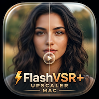
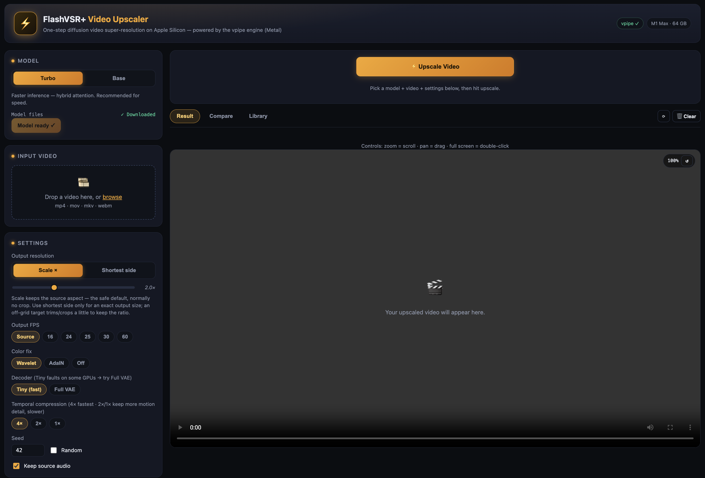
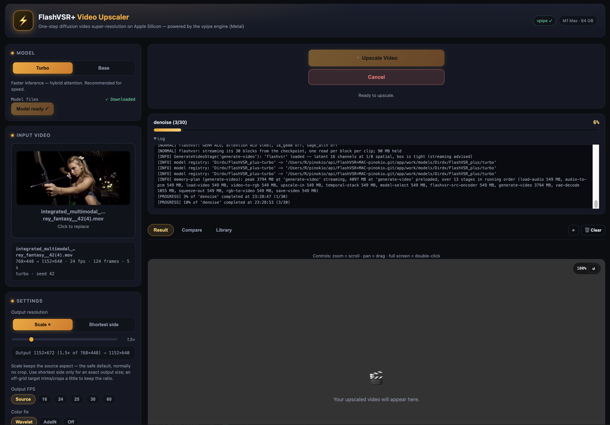
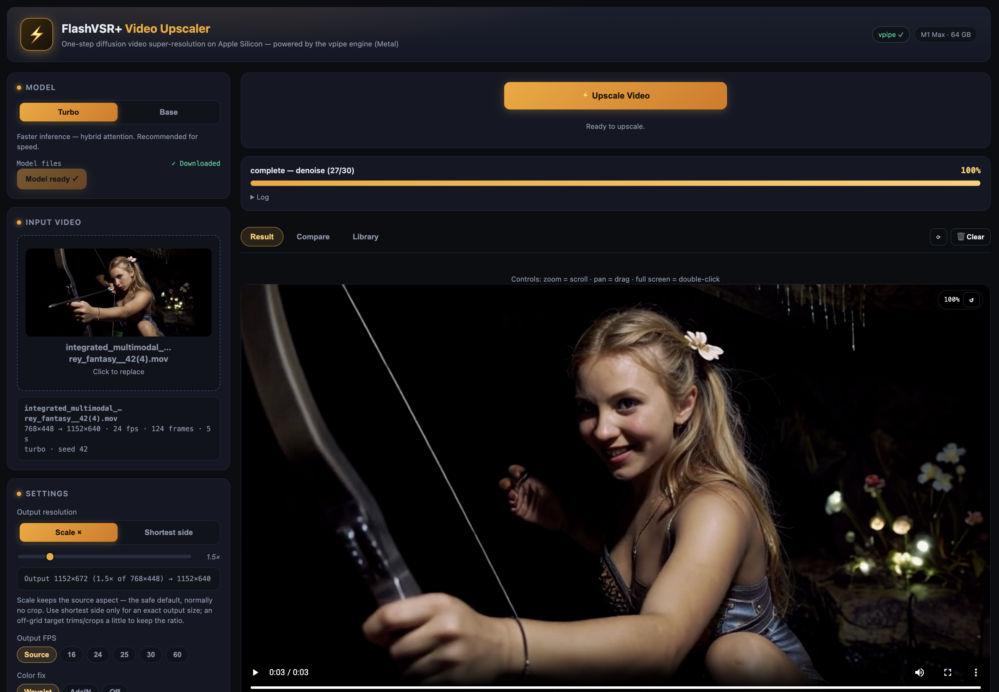
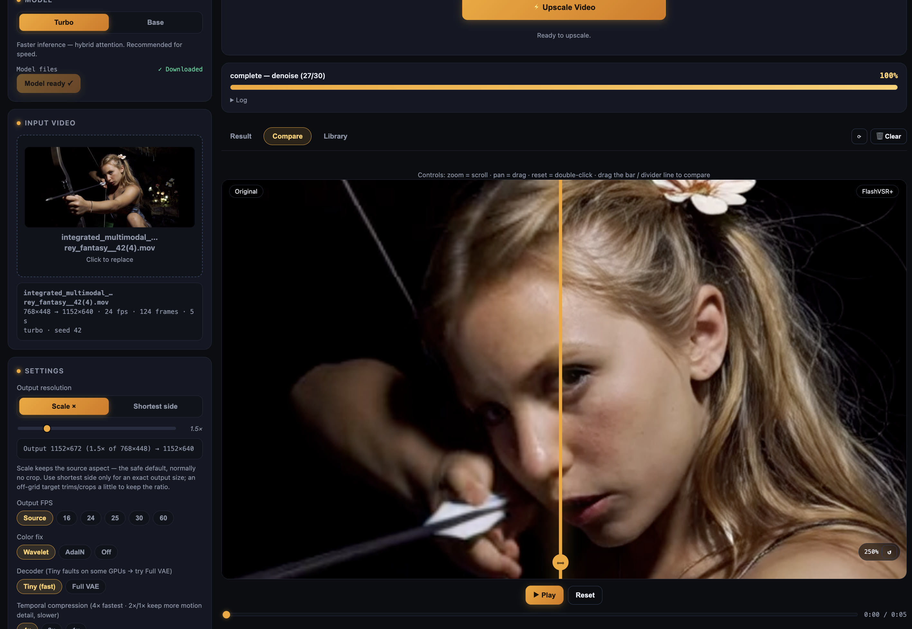
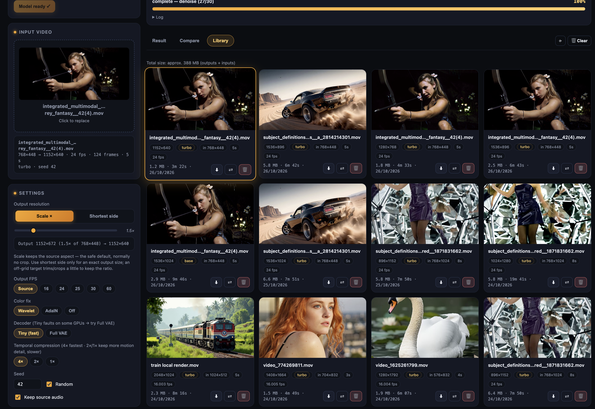

# FlashVSR+ Video Upscaler ⚡

<div align="center">



</div>

A one-click Pinokio app that runs the **FlashVSR+** one-step diffusion video
super-resolution model **natively on Apple Silicon Macs** using the
**[vpipe](https://github.com/tgo-app-dev/vpipe)** engine (Metal).

> **The most efficient, fastest video upscaling on Mac** — FlashVSR+'s one-step
> diffusion pipeline running at full GPU speed through vpipe's Metal backend.

Upload a video, pick a model variant (**Turbo** for speed, **Base** for quality) and a target
resolution (720p → 4K), and get a color-faithful high-resolution upscale — with a live
**before/after comparison slider** (synchronized dual playback), a background
**job system with live progress + log tail**, and a **library** of all your results.

No PyTorch/CUDA, no Docker. Everything runs on the Apple GPU via vpipe's Metal backend.
The web UI is a lightweight **FastAPI + vanilla HTML/JS** app.

## What it does

FlashVSR+ is a one-step diffusion framework for video super-resolution (hybrid attention +
reward-yield distillation). Given a low-quality video it produces a sharp high-quality result
in a **single denoising step** per chunk — no prompt, no multi-step schedule. This app:

- Fetches the [FlashVSR_plus](https://huggingface.co/ruchangyao/FlashVSR_plus) weights
  **on demand from the UI** (not at install), with per-file status and resumable fetches
- Runs the **official reference pipeline** (load → prepare → temporal stack → FlashVSR
  source-encoder → one-step DiT → VAE decode → squeeze → encode) through the vpipe CLI
- Exposes the real tunable knobs: **target resolution** (720p/1080p/1440p/4K/custom,
  with aspect-lock and match-source-aspect), **output FPS** (source/16/24/25/30/60),
  **model variant**, **decoder** (Tiny fast / Full VAE), **seed** (fixed or random),
  **color fix** (wavelet / AdaIN / off), **temporal compression** (4×/2×/1×), and
  **audio passthrough**
- Restores video in temporal chunks (17-frame lead, then 16-frame cadence) with the
  shared TCDecoder — no flicker between chunks
- **Result** tab: plays the upscale with **zoom + pan** (scroll to zoom, drag to pan,
  double-click to full-screen) and a download button
- **Compare** tab: a before/after **slider** (drag the divider or slider), synchronized
  play/pause, a **seek bar** with a time readout, and zoom + pan
- Runs upscaling as **background jobs** (submit → poll progress → play inline) with
  live phase, clip counter, progress bar, **log tail**, and a **cancel** button
- **Library** tab: every finished upscale lands in `app/outputs/` with a sidecar
  `meta.json` recording the full run (variant, resolution, seed, source info); each
  card can be **downloaded**, **compared**, **deleted** on its own, or clicked to open
  on the **Result** page
  
## What it can't do / Honest expectations :
- Cannot magically transform your very low resolution videos/ fully garbled faces in long shot videos into fully refined details.
- If the faces or details are intact, this upscaler does a very good job of restoring/adding in details faithfully like fine hair, eyes, facial structure, fine textures etc.
- In my testing, this isnt better than seedvr2(images). But for videos, Flashvsr+ is a very good, and currently only feasible option, way faster and efficent than seedvr2.
  
### Model variants

| Variant | Weights | Notes |
|---|---|---|
| **Turbo** — *default* | `turbo/dit.safetensors` + `lq_proj_in.safetensors` | Faster inference (hybrid attention). Recommended. |
| **Base** | `base/dit.safetensors` + `lq_proj_in.safetensors` | Higher reconstruction quality (sparse attention). |

Both variants share the decoder (`TCDecoder.ckpt`), VAE (`Wan2.1_VAE.pth`), and prompt
file — shared files are fetched once and reused. Weights land in
`app/work/models/ruchangyao/FlashVSR_plus/` (vpipe's model cache, registered in its
model DB).

> **Requires Apple Silicon (arm64 macOS).** vpipe runs on the Apple GPU via Metal;
> this app is not available on Intel Macs or other platforms.

## 💻 Requirements

| Component | Minimum | Recommended |
|-----------|---------|-------------|
| **Chip** | M1 | M1 Pro/Max or better |
| **RAM** | **16 GB** (720p upscale, 5 sec) | **24 GB+** (1440p/4K) |
| **OS** | macOS 26+ (Tahoe) | macOS 27+ (Golden gate) |
| **Storage** | ~12 GB free (engine + Turbo weights) | ~18 GB free (both variants) |

- On an M1 max 64gb(24c gpu), a 720p(1280x768) upscale using Turbo Model, from a 768x448, 5 sec, 24fps source video took ~5mins upscaling, and peaked ~12gb ram. Longer clips and higher resolution takes more time and much higher memory.
- **WARNING** : the app/engine is highly GPU Intensive, and i strongly suggest to not use anything else during an upscale(browsers, video player etc), or else chances are to encounter metal GPU error.
  
No compiler, no Homebrew, no system file dependencies: the vpipe engine is installed as a
**prebuilt release bundle** (with-ffmpeg build — FFmpeg ships inside it), and the
web app's Python dependencies (including PyAV for video metadata) live in an
isolated venv managed by `uv`.

## 📦 Installation (One-Click)

1. **Download Pinokio:** [pinokio.computer](https://pinokio.computer)
2. **Copy this Repository URL:** `https://github.com/Rdx-ai-art/FlashVSR.plus.MAC-pinokio.git`
3. **Paste into Pinokio:** Discover > Download from URL > paste and select Download.

		> OR search directly inside pinokio's app section for this app, Select install.
3. Click **Start**, then **Open Web UI**.
4. In the UI: pick a model variant → **Fetch model** → drop a video → select settings → **⚡ Upscale Video**.

## 🚀 How to use

1. **Model** — choose **Turbo** or **Base** and hit **Fetch model** (first time only).
   You'll see per-file download status and a live progress bar.
2. **Input Video** — drop an `mp4` / `mov` / `mkv` / `webm` file.
3. **Settings** — pick the target resolution (with aspect-lock / match-source-aspect),
   output FPS, color fix, decoder (Tiny fast / Full VAE), temporal compression,
   seed (or random), and whether to keep the source audio.
4. **⚡ Upscale Video** — the ⚡ logo flickers to life and the job runs in the
   background; watch the phase, clip counter and log tail (the red **Cancel** stops it).
   When it's done, the result appears in the **Result** tab.
5. **Compare** — drag the divider (or the slider) to sweep between original and
   upscaled; **Play** keeps both in sync; use the **seek bar** to jump around.
   Scroll to zoom, drag to pan, double-click to reset.
6. **Library** — all past outputs with previews and badges. Each card: **⬇ download**,
   **⇄ compare**, **🗑 delete** (just that generation), or click to open it on the
   **Result** page. **⟳** refreshes; **🗑 Clear** wipes the whole library.

   ## 📸 Screenshots










### 🎬 Video upscaling

- Source videos are decoded to RGB, resampled to the DiT working resolution, stacked
  into temporal batches, encoded by the FlashVSR source-encoder, denoised in **one DiT
  step per chunk**, decoded by the shared TCDecoder, squeezed to the exact target
  resolution, and re-encoded to H.264 (`yuv420p`).
- Audio (when enabled) is carried through the source's own track (2ch / 44.1 kHz).
- Output resolution dimensions are rounded down to multiples of 16 (VAE requirement);
  the `generate-video` stage aligns them to its own VAE stride internally.

### 🕹️ Tips

- **Out of memory / slow?** Use the **Turbo** variant, the **Tiny** decoder, temporal
  compression **4×**, and target 1080p before 1440p/4K.
- **Slightly off colors?** Try color fix **Wavelet** (default) → **AdaIN** → **Off**.
- **Long videos** run as many sequential chunks — the clip counter in the job bar
  tells you where it is.

## 💡 How it works

- `install.js` installs the dependencies from requirements using the prebuilt Vpipe engine pulled from my own repo(app/vpipe).
- `start.js` launches the FastAPI app (`app/app.py`) in the `app/` venv and captures
  the printed URL to surface the **Open Web UI** tab.
- The web app builds a **pipeline JSON** (the official FlashVSR+ reference pipeline,
  parameterized) into `app/work/`, then runs `vpipe --launch <pipeline>` as a
  subprocess and parses its stdout — `[INFO]/[WARN]/[ERROR]` lines feed the log tail,
  and `[PROGRESS]` milestone lines (vpipe's piped-mode progress) drive the phase,
  clip counter and progress bar.
- Input video metadata (resolution/fps/frames/audio) is read with **PyAV** inside the
  app venv — it bundles its own FFmpeg libraries, so no system `ffprobe` is needed.
- Model weights are fetched with vpipe's own `model-fetch` stage
  (`--launch-stage model-fetch --stage-cfg model_path=ruchangyao/FlashVSR_plus
  --stage-cfg model_variant=turbo|base`), which downloads to `app/work/models/` and
  registers them in vpipe's model DB.

## 🔧 API Documentation

Base URL: `http://127.0.0.1:<port>` (port is printed by `start.js`).

### Endpoints

| Method | Path | Description |
|---|---|---|
| GET | `/api/system` | Chip, RAM, vpipe availability |
| GET | `/api/models` | Variants with per-file status, ready flag, in-flight fetch |
| POST | `/api/models/fetch` | Body `{"variant": "turbo"}` → start background fetch |
| GET | `/api/jobs` | All jobs (newest first) |
| GET | `/api/jobs/{id}` | Job state: `state`, `phase`, `pct`, `desc`, `log[]`, `error` |
| POST | `/api/jobs/{id}/cancel` | Gracefully cancel (SIGINT, then SIGTERM) |
| POST | `/api/video/upscale` | Multipart: `file` (video) + `params` (JSON string) → `{job}` |
| GET | `/api/outputs` | Library: finished outputs with metadata |
| POST | `/api/outputs/clear` | Delete all outputs |
| POST | `/api/outputs/{job_id}/delete` | Delete one generation (output + its source upload) |
| GET | `/api/download/{job_id}` | Download result MP4 |
| GET | `/api/outputs/{job_id}/{name}` | Serve any output file (e.g. `output.mp4`) |
| GET | `/api/uploads/{job_id}/{name}` | Serve a job's input file (for compare) |

`params` JSON:

```json
{
  "variant": "turbo",
  "width": 1920,
  "height": 1088,
  "fps": null,
  "frames": 49,
  "seed": 42,
  "group_size": 24,
  "color_fix": "wavelet",
  "decoder": "tiny",
  "temporal_compression": 4,
  "keep_audio": true
}
```

(`fps: null` = use the source video's frame rate.)

### 🐍 Python

```python
import json, time, requests

BASE = "http://127.0.0.1:7860"

# 1) Fetch a model variant (background)
r = requests.post(f"{BASE}/api/models/fetch", json={"variant": "turbo"}).json()
job = r["job"]
while True:
    j = requests.get(f"{BASE}/api/jobs/{job}").json()["job"]
    if j["state"] in ("done", "failed", "cancelled"):
        break
    time.sleep(1)

# 2) Upscale a video (multipart: file + params JSON string)
params = json.dumps({
    "variant": "turbo", "width": 1920, "height": 1088,
    "seed": 42, "group_size": 24, "color_fix": "wavelet",
    "decoder": "tiny", "temporal_compression": 4, "keep_audio": True,
})
with open("input.mp4", "rb") as f:
    r = requests.post(f"{BASE}/api/video/upscale",
                      files={"file": f}, data={"params": params}).json()
job = r["job"]

# 3) Poll until done, then download
while True:
    j = requests.get(f"{BASE}/api/jobs/{job}").json()["job"]
    print(j["phase"], f"{j['pct']:.0f}%")
    if j["state"] in ("done", "failed", "cancelled"):
        break
    time.sleep(1)

with open("output.mp4", "wb") as f:
    f.write(requests.get(f"{BASE}/api/download/{job}").content)
```

### ⌨️ JavaScript

```javascript
// Fetch model
const { job: fjob } = await fetch("http://127.0.0.1:7860/api/models/fetch", {
  method: "POST",
  headers: { "Content-Type": "application/json" },
  body: JSON.stringify({ variant: "turbo" }),
}).then((r) => r.json());

// Upscale
const fd = new FormData();
fd.append("file", videoFile);
fd.append("params", JSON.stringify({
  variant: "turbo", width: 1920, height: 1088,
  seed: 42, group_size: 24, color_fix: "wavelet",
  decoder: "tiny", temporal_compression: 4, keep_audio: true,
}));
const { job } = await fetch("http://127.0.0.1:7860/api/video/upscale", {
  method: "POST",
  body: fd,
}).then((r) => r.json());

// Poll
while (true) {
  const j = (await fetch(`http://127.0.0.1:7860/api/jobs/${job}`).then((r) => r.json())).job;
  console.log(j.phase, j.pct + "%");
  if (["done", "failed", "cancelled"].includes(j.state)) break;
  await new Promise((res) => setTimeout(res, 1000));
}
```

### cURL

```bash
# System info
curl http://127.0.0.1:7860/api/system

# List models / status
curl http://127.0.0.1:7860/api/models

# Fetch the Turbo model
curl -X POST http://127.0.0.1:7860/api/models/fetch \
  -H 'Content-Type: application/json' -d '{"variant":"turbo"}'

# Submit a video upscale
curl -X POST http://127.0.0.1:7860/api/video/upscale \
  -F "file=@input.mp4" \
  -F 'params={"variant":"turbo","width":1920,"height":1088,"seed":42,"group_size":24,"color_fix":"wavelet","decoder":"tiny","temporal_compression":4,"keep_audio":true}'

# Poll progress
curl http://127.0.0.1:7860/api/jobs/<JOB_ID>

# Cancel
curl -X POST http://127.0.0.1:7860/api/jobs/<JOB_ID>/cancel

# Download the result
curl -OJ http://127.0.0.1:7860/api/download/<JOB_ID>

# Delete a single generation (from the Library)
curl -X POST http://127.0.0.1:7860/api/outputs/<JOB_ID>/delete
```

## 📁 Project structure

```
FlashVSR.plus.MAC-pinokio.git/
├── app/
│   ├── app.py              # FastAPI backend — job runner, vpipe subprocess + parsing
│   ├── requirements.txt
│   ├── static/             # Web UI (vanilla HTML/CSS/JS)
│   │   ├── index.html
│   │   ├── style.css
│   │   └── app.js
│   ├── env/                # Python venv (created by install.js)
│   ├── work/               # vpipe CWD: models/, data.mdb, pipelines (gitignored)
│   ├── uploads/<job>/      # Job input videos (gitignored)
│   └── outputs/<job>/      # output.mp4 + meta.json (gitignored)
├── vpipe/                  # Prebuilt vpipe engine (DMG-installed by install.js)
├── install.js
├── start.js
├── update.js
├── reset.js
├── pinokio.js
├── pinokio.json
└── README.md
```

## 📄 License

This launcher and web app are provided under MIT license. The FlashVSR+ model weights are
distributed under their own terms (see the
[Hugging Face repo](https://huggingface.co/ruchangyao/FlashVSR_plus)); the vpipe
engine is [Apache-2.0](https://github.com/tgo-app-dev/vpipe/blob/main/THIRD_PARTY_LICENSES.md).

## 🙏 Credits

- [FlashVSR+](https://huggingface.co/ruchangyao/FlashVSR_plus) — Ruchang Yao et al.
  ([paper](https://arxiv.org/abs/2610.17552), [project page](https://flashvsr.tech))
- [vpipe](https://github.com/tgo-app-dev/vpipe) — TGO: the local AI media engine
- [Pinokio](https://pinokio.computer) — one-click app launcher
